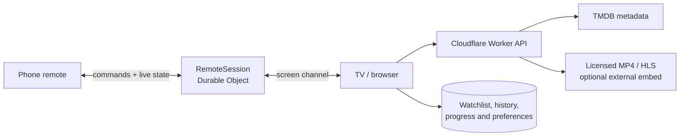

<div align="center">
  
  <h1>CINERA</h1>
  <p><strong>A cinematic movie and TV experience for phones, browsers, and Android TV.</strong></p>
  <p>Discover a title, choose a playback source, and control the room from your phone.</p>

  <p>
    <a href="https://cinera-by-hich.hiranthadiass4.workers.dev/"><strong>Open the live app</strong></a>
    ·
    <a href="#quick-start">Run locally</a>
    ·
    <a href="#phone-remote">Phone remote</a>
    ·
    <a href="#deployment">Deploy</a>
  </p>

  <p>
    
    
    
    
    
  </p>
</div>

<p align="center">
  
</p>

## The experience

Cinera is a full-stack streaming portal focused on a clean ten-foot experience. The interface adapts from touch phones to desktop browsers and remote-controlled TV screens without splitting the product into separate apps.

| Discover | Watch | Control | Continue |
| --- | --- | --- | --- |
| Search, filters, moods, trending rows, cast, trailers, and recommendations. | Select licensed MP4/HLS sources or an optional external fallback. | Pair a phone by QR and use a trackpad, TV pointer, keyboard, and playback controls. | Keep a watchlist, history, preferences, and playback progress locally without an account. |

## A remote built for the sofa

<table>
  <tr>
    <td width="62%">
      
    </td>
    <td width="38%" valign="top">
      <h3>One QR. One private session.</h3>
      <p>The TV creates a temporary pairing code. The phone joins the same Cloudflare Durable Object session and exchanges live commands and screen state over WebSockets.</p>
      <p><strong>No account, Bluetooth, or shared Wi-Fi discovery is required.</strong></p>
    </td>
  </tr>
</table>

<a id="phone-remote"></a>
<table>
  <tr>
    <td width="35%" align="center">
      
    </td>
    <td width="65%" valign="top">
      <h3>Phone remote</h3>
      <p>A restrained, Apple-TV-inspired controller designed for one-handed use.</p>
      <ul>
        <li><strong>Pointer mode</strong> moves a visible cursor and highlights selectable TV elements.</li>
        <li><strong>Focus mode</strong> turns directional swipes into accelerated TV navigation.</li>
        <li>Tap selects, double-tap toggles playback, long-press confirms, and the edge rail scrolls.</li>
        <li>The synchronized keyboard opens automatically when a TV text field receives focus.</li>
        <li>Playback, volume, mute, fullscreen, restart, menu, and section shortcuts remain one tap away.</li>
        <li>Supported browsers receive lightweight haptic feedback for movement and actions.</li>
      </ul>
    </td>
  </tr>
</table>

> The Remote entry is shown only on confirmed TV devices. It remains hidden on phones, tablets, and desktop browsers, including large landscape touch screens.

## Catalog, without the clutter

<p align="center">
  
</p>

The catalog uses TMDB metadata for discovery while keeping playback providers separate. Movies and series can be filtered by genre, year, period, rating, and popularity. Search includes live suggestions, recent terms, voice input where available, and full result pages.

## Feature map

| Area | Included |
| --- | --- |
| Home | Featured stories, editorial rows, continue watching, Surprise Me |
| Discovery | Movies, series, genres, years, ratings, sorting, pagination |
| Search | Live suggestions, voice search, recent searches, mixed title results |
| Details | Metadata, cast, seasons, episodes, trailers, recommendations, provider links |
| Playback | MP4, HLS, iframe sources, server failover, resume progress, Data Saver |
| Player tools | Start Over, sleep timer, Picture-in-Picture, autoplay next, sharing, shortcuts |
| Personal | Searchable watchlist, undo, exact episode resume, cross-tab sync, library backup import/export |
| TV | Compact ten-foot layout, spatial focus navigation, Android/LG/Tizen remote keys, legacy browser fallback |
| Phone remote | QR pairing, trackpad, cursor, focus gestures, keyboard, haptics, playback controls |
| PWA | Installable manifest, offline shell, cache rotation, mobile home-screen support |

## Architecture



| Layer | Technology | Responsibility |
| --- | --- | --- |
| Interface | React 18, React Router, Lucide | Responsive UI, routes, search, watch and remote experiences |
| Playback | Native video, HLS.js, iframe integration | Direct streams, adaptive HLS, external fallback |
| Edge API | Cloudflare Workers | Catalog normalization, source selection, caching, security headers |
| Remote relay | Durable Objects WebSockets | Isolated screen/phone sessions, presence and command relay |
| Data | TMDB API plus local sample catalog | Metadata, art, seasons, discovery and credential-free fallback |
| Client storage | `localStorage` and `sessionStorage` | Watch state and short-lived remote pairing tokens |

## Quick start

### Requirements

- Node.js 20.19 or newer; Node.js 22 is recommended
- npm
- Optional TMDB API Read Access Token for the full catalog

### macOS / Linux

```bash
npm install
cp .dev.vars.example .dev.vars
npm run dev
```

### Windows PowerShell

```powershell
npm install
Copy-Item .dev.vars.example .dev.vars
npm run dev
```

Open <http://localhost:5173>. Without TMDB credentials, Cinera starts with a safe sample catalog so the complete interface remains testable.

### Local environment

```env
TMDB_READ_ACCESS_TOKEN=your_token_here
ENABLE_VIDY=true
```

| Variable | Required | Purpose |
| --- | --- | --- |
| `TMDB_READ_ACCESS_TOKEN` | No | Enables the complete TMDB catalog; sample data is used when absent |
| `ENABLE_VIDY` | No | Enables or disables the optional external iframe fallback |

Never commit `.env`, `.dev.vars`, API tokens, or account credentials.

## Playback sources

Direct HTTPS MP4 and HLS sources in `worker/sources.js` are preferred. Configure only media you are authorized to distribute.

On detected TV browsers, the optional Vidy fallback offers a remote-friendly full-page launch first. This avoids the autoplay and focus restrictions that many Android TV and webOS browsers apply to cross-origin iframes; the remote Back button returns to Cinera. An in-page embed remains available as a fallback.

```js
export const playbackSources = {
  'movie:10378': [
    {
      id: 'licensed-file-1',
      label: 'Primary CDN',
      type: 'video',
      url: 'https://cdn.example.com/authorized-film.mp4',
    },
  ],
  'tv:1396:1:1': [
    {
      id: 'licensed-episode-1',
      label: 'Adaptive HLS',
      type: 'hls',
      url: 'https://cdn.example.com/season-1/episode-1/master.m3u8',
    },
  ],
};
```

Episode-specific keys use `tv:{tmdbId}:{season}:{episode}`. Generic `tv:{tmdbId}` sources can be used only when the same authorized stream is intentionally shared across episodes.

The included Big Buck Bunny source is an openly licensed playback sample. If your own server blocks cross-origin requests, configure CORS or framing permissions on that server; the frontend does not bypass them.

## API reference

| Method | Route | Purpose |
| --- | --- | --- |
| `GET` | `/api/health` | Runtime and catalog health |
| `GET` | `/api/home` | Featured titles and home rows |
| `GET` | `/api/search?q=...&page=1` | Mixed movie and series search |
| `GET` | `/api/genres/:kind` | Genre catalog for `movie` or `tv` |
| `GET` | `/api/browse/:kind` | Filtered and paginated discovery |
| `GET` | `/api/title/:kind/:id` | Normalized title details |
| `GET` | `/api/season/{id}/{season}` | TV season and episode data |
| `GET` | `/api/sources/:kind/:id` | Direct and external playback choices |
| `WS` | `/api/remote/socket` | Private relay using `pair` and `role` parameters |

## Project structure

```text
cinera_app/
├── public/                 PWA assets, security headers and service worker
├── src/
│   ├── components/         Search, player, cards, layout and watch tools
│   ├── lib/                API, state, PWA, TV navigation and remote logic
│   └── pages/              Home, browse, details, watch, pairing and remote
├── test/                   Worker, player, TV and gesture tests
├── worker/
│   ├── catalog.js          TMDB and sample catalog normalization
│   ├── sources.js          Authorized playback source configuration
│   └── index.js            API routes and Durable Object relay
├── wrangler.jsonc          Worker, assets and Durable Object configuration
└── vite.config.js          React and Cloudflare build integration
```

## Validation

```bash
npm run validate
```

The validation pipeline checks Worker syntax, runs deterministic tests, builds the production client and Worker bundles, validates asset routing, and performs a Wrangler deployment dry-run.

Current suite: **57 passing tests** covering API cancellation, retries and timeouts, discovery URLs, library validation and backup merging, offline caches, source failover, playback messages, native HLS/fullscreen compatibility, TV detection, remote gestures, and CSP-safe legacy loading.

GitHub Actions runs this validation pipeline on pushes to main and pull requests. It uses the sample catalog and does not need production secrets.

### Browser regression checks

With Node.js 22+, run `npm run dev` and start a separate Chromium browser with remote debugging on port 9226. For example, in Windows PowerShell:

```powershell
Start-Process -FilePath "$env:ProgramFiles\Google\Chrome\Application\chrome.exe" -WindowStyle Hidden -ArgumentList '--headless=new', '--remote-debugging-port=9226', "--user-data-dir=$env:TEMP\cinera-browser-tests"
npm run test:browser
```

The suite creates an isolated browser context, leaving ordinary browser storage untouched. Its **50 checks** cover library management, cross-tab sync, backup import/export, discovery, error recovery, focus, scroll restoration, mobile layouts, playback lifecycle, and the live phone remote relay. Playback events use deterministic fixtures; this does not certify third-party stream availability or physical TV hardware. Screenshots and downloaded fixtures go into the ignored `.audit/browser/` directory.

Set `CINERA_TEST_URL` or `CINERA_CDP_URL` to use different app or browser-debugging endpoints. Browser tests are an additional local check and are separate from `npm run validate`.

## Deployment

### Wrangler

```bash
npx wrangler login
npm run deploy
```

The deployment creates or updates the `cinera-by-hich` Worker. The QR remote uses the `RemoteSession` SQLite-backed Durable Object declared in `wrangler.jsonc`; Wrangler applies its initial migration during deployment.

Store `TMDB_READ_ACCESS_TOKEN` in **Workers & Pages → Settings → Variables and Secrets**. The ignored local `.env` file may be used by the provided deploy script, but it must never be added to Git.

### Git-connected deployment

| Setting | Value |
| --- | --- |
| Production branch | `main` |
| Build command | `npm run build` |
| Deploy command | `npx wrangler deploy` |

## Responsible use

- TMDB provides metadata and artwork, not movie files or streaming rights.
- Vidy, when enabled, is an independent external provider. Its availability, advertising, safety, and licensing are outside Cinera's control.
- You are responsible for the rights and availability of every configured playback source.
- Saved lists and progress are browser-local; Cinera does not currently provide user accounts or cloud sync.
- Cinera is independently branded and is not affiliated with TMDB, Vidy, HydraHD, Apple, or any streaming platform.

---

<p align="center">
  Built by <strong>Hich Web</strong> for movie nights on every screen.
</p>
